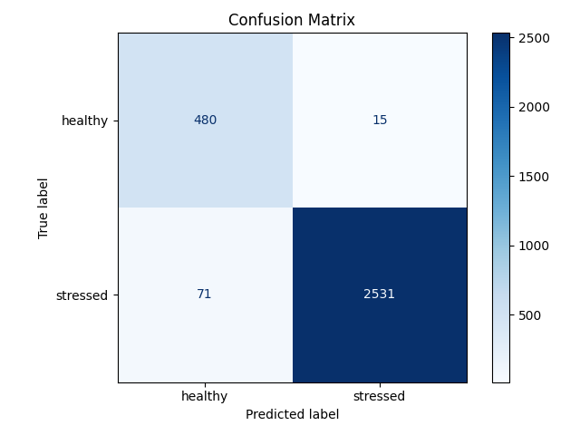
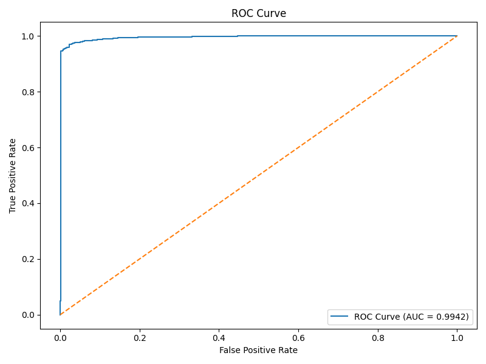

# Plant Stress Classification with a CNN

**Balajishnu Yabaluri**

A Python/PyTorch project that classifies leaf images as healthy or stressed using transfer learning with an ImageNet-pretrained ResNet18. In this project, “stressed” pools the dataset’s disease categories; it is not a direct measurement of physiological or environmental stress.

## Start here

- [Main training and evaluation code](plant_stress_train.py)
- [Saved numerical results](metrics.json)
- [Confusion matrix](confusion_matrix.png) and [ROC curve](roc_curve.png)
- [Single-image prediction](predict_single.py) and [Grad-CAM visualization](gradcam.py)

## My implementation

I implemented the dataset preparation and binary relabeling, image preprocessing and augmentation, seeded train/validation/test split, weighted sampling for class imbalance, replacement classification head and training loop, evaluation metrics and plots, single-image prediction, and visualization scripts. The ResNet18 architecture and pretrained weights come from torchvision; I trained the replacement classification head with the backbone parameters frozen.

## Method

The prepared dataset contains 20,638 images: 3,221 healthy and 17,417 stressed. Images are resized to 224 × 224 pixels. Training uses random horizontal flips, rotations and brightness/contrast augmentation. The code uses a 70%/15%/15% image-level split with seed 42, inverse-frequency weighted sampling, cross-entropy loss, Adam (learning rate 0.001), batch size 32, and five epochs. The checkpoint with the best validation accuracy is evaluated on the test set.

## Saved results

These are the existing project outputs, not a new training run performed for this upload. The test split contains 3,097 images. Precision, recall and F1 refer to the stressed class.

| Metric | Value |
| --- | ---: |
| Accuracy | 97.22% |
| Precision | 99.41% |
| Recall | 97.27% |
| F1 | 98.33% |
| ROC-AUC | 0.9942 |




Training diagnostics: [loss](loss_curve.png) · [validation accuracy](val_accuracy_curve.png).

## Use the trained model without retraining

Download `plant_stress_model.pth` from the [model release](https://github.com/Jishnuy4998/plant-stress-classification/releases/tag/v1.0.0) and place it in the project root beside `predict_single.py`. Install the requirements, then run `python predict_single.py path/to/leaf.jpg`. Dataset downloads are only necessary for training. The original checkpoint loads successfully and a sample prediction was checked; it was not retrained for this upload.

## Running the project

Use a Python environment compatible with the package versions in requirements.txt (the versions recorded in the original local environment).

```sh
python -m venv .venv
source .venv/bin/activate
pip install -r requirements.txt
python download_datasets.py
```

The original download script fetches [PlantVillage on Kaggle](https://www.kaggle.com/datasets/emmarex/plantdisease) and [PlantDoc on Kaggle](https://www.kaggle.com/datasets/abdulhasibuddin/plant-doc-dataset). Follow Kaggle’s access and licensing requirements. If an archive includes an extra enclosing directory, arrange the PlantVillage class folders directly under `data/downloads/plantvillage/` before relabeling:

```text
data/downloads/plantvillage/
    Tomato_healthy/
    Tomato_Early_blight/
    ...
```

```sh
python relabel_to_binary.py
python plant_stress_train.py
python predict_single.py path/to/leaf.jpg
python gradcam.py path/to/leaf.jpg
```

Training writes a local `plant_stress_model.pth` checkpoint and evaluation files in `outputs/`. This repository stores the original evaluation files at its root for easy review. Raw datasets and the local environment are excluded. The large trained checkpoint is available separately in the model release. Download that checkpoint or train the model before running prediction or Grad-CAM. Some supplementary visualization scripts contain example image paths that must be changed to an image in your downloaded data.

## Scope and limitations

- Based on my visual inspection, many PlantVillage examples show obvious visible damage or disease symptoms; I estimate that only around 10% are visually ambiguous. This is an informal estimate, not a measured dataset statistic. Evaluating and training on a dataset with subtler symptoms and early-stage disease would help assess and potentially improve performance on harder cases.
- Evaluation uses a random image-level split of PlantVillage, not an independent field dataset or a split grouped by plant, leaf, or source. These results do not establish field performance.
- PlantDoc is downloaded by the helper script, but the main training script does not evaluate it. No PlantDoc results are claimed here.
- Disease categories are combined into one stressed label; the model does not identify individual diseases or directly measure abiotic stress.
- The original pipeline uses ToTensor without ImageNet mean/std normalization. The source is preserved as implemented; this is a possible improvement to investigate.
- The architecture drawing script produces a simplified CNN illustration, not an exact diagram of ResNet18. Edge detection is a separate visualization and is not part of training preprocessing.

## Files

`relabel_to_binary.py` prepares labels; `plant_stress_train.py` trains and evaluates; `predict_single.py` predicts one image; `gradcam.py` and `visualize_layers.py` inspect model responses. The remaining scripts create preprocessing examples and a schematic diagram.

Dataset images and pretrained model weights belong to their respective providers. Consult their terms before reuse.
